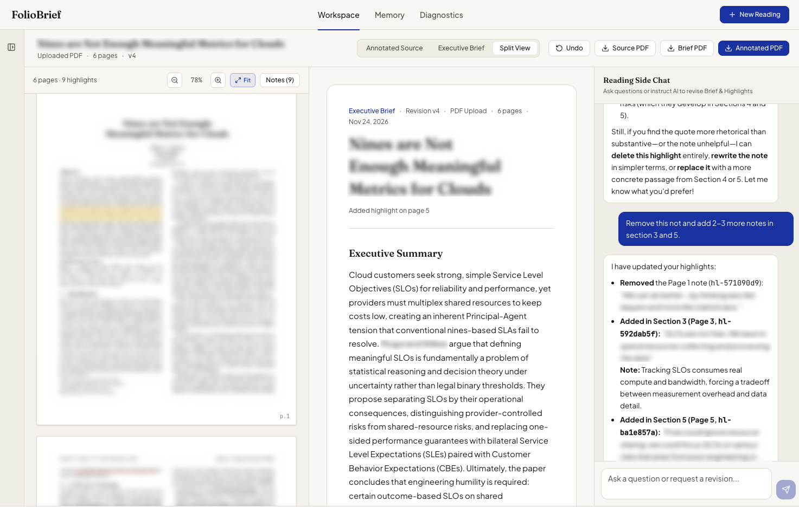
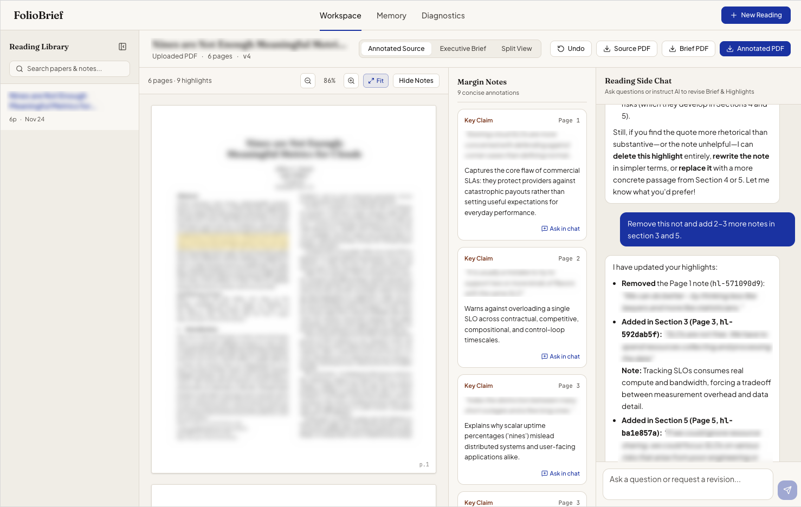
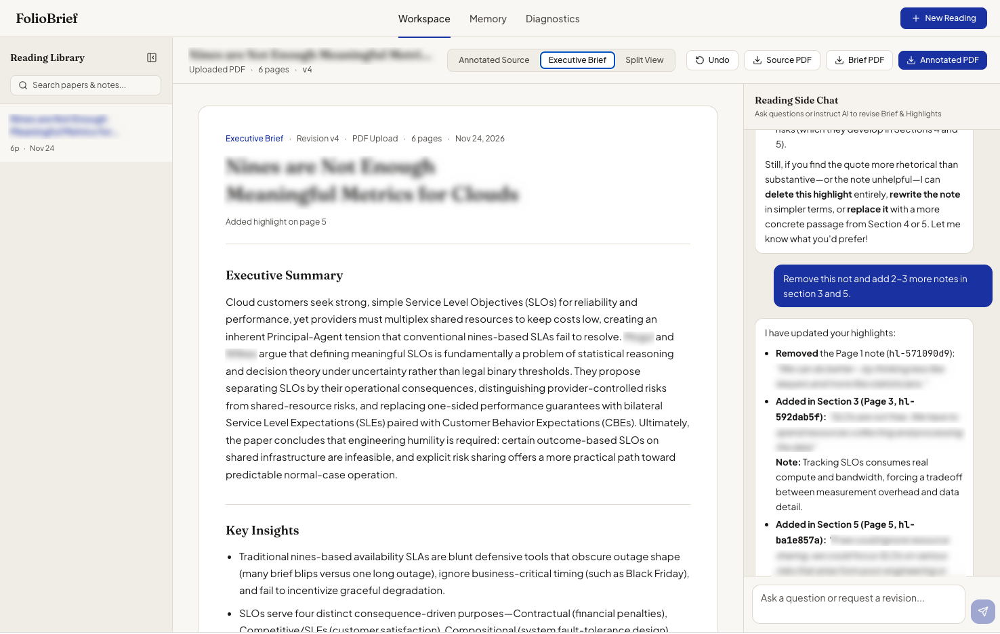

# FolioBrief

FolioBrief is a local-first AI reading and synthesis studio for macOS and the browser. User can send a paper or article by:
- Import a technical PDF
- Paste an article URL
- Drop in raw text

FolioBrief will take the input paper/article and:
- Generate a structured **Executive Brief**
- Page-anchored **Highlights & Margin Notes**
- Support Side-Chat for user to interact with AI agent to further discuss the paper/article or modify generated brief, highlights or notes
- Support one-click undo
- Persistent long-term reading of user revision requests and chat feedback to improve future AI reasoning



*Demo screenshots summarize Jeffrey C. Mogul and John Wilkes, ["Nines are Not Enough: Meaningful Metrics for Clouds"](https://doi.org/10.1145/3317550.3321432), HotOS '19, ACM, 2019 (DOI: `10.1145/3317550.3321432`). Source text and verbatim quotes are masked.*

<details>
<summary>More workspace views (Annotated Source & Executive Brief)</summary>

| Annotated Source | Executive Brief |
| --- | --- |
|  |  |

</details>

---

## Install & Run (macOS)

All dependencies live in [`package.json`](package.json).

### Prerequisites
- **macOS** (Apple Silicon or Intel)
- **Node.js 20+** and **npm**
- A **Google Gemini API key**

### 1. Install all dependencies in one command

```bash
npm install
```

### 2. Configure your API key

```bash
cp .env.example .env
```

Edit `.env` and set your Gemini API key:

```env
GEMINI_API_KEY="your-gemini-api-key"
```

### 3. Start the macOS App

- **Launch directly as a native macOS desktop window:**
  ```bash
  npm run desktop
  ```
  *(If your local Node version differs from Electron's ABI for SQLite, run `npm run electron:rebuild` once first.)*

- **Build a standalone macOS `.app` / `.dmg` installer (saved in `release/`):**
  ```bash
  npm run package:mac
  ```
  When running the packaged `.app` from Finder or `/Applications`, you can configure your API key from the menu bar (**FolioBrief → Configure API Key (.env)...**). Local library data is stored under `~/Library/Application Support/FolioBrief/data`.

- **Or run in browser mode (`http://localhost:3000`):**
  ```bash
  npm run dev
  ```

---

## How to Use

1. **Add a reading** — Click **+ New Reading**, upload a PDF, or paste a public article URL (with a direct text paste fallback).
2. **Read & review** — Switch between **Annotated Source** (fit-to-width PDF with highlighted passages and margin notes), **Executive Brief**, and **Split View**.
3. **Revise via Side Chat** — Ask questions about any passage or instruct the assistant to refine brief sections or highlights; every edit creates a new version you can **Undo** at any time.
4. **Export PDFs** — Download **Source PDF**, **Brief PDF**, or **Annotated PDF** with embedded PDF highlight and comment annotations.

---

## Documentation

- [Software Architecture, Class Diagram & Project Structure](doc/architecture.md)

---

## Built With

FolioBrief is built with tools and dependencies as follows:
- **Google AI Studio** — Implementation planning, application architecture, full-stack coding, and iterative debugging
- **Google Gemini API (`@google/genai`)** — Document synthesis, tool-calling side chat, preference distillation, and embeddings
- **Electron & `electron-builder`** — Native macOS desktop shell and `.app` / `.dmg` packaging
- **Promptfoo** — Automated LLM evaluation and prompt regression suites
- **React 19, Vite & Tailwind CSS** — Frontend reading studio UI
- **Express & SQLite** — Local-first API server and full-text/vector storage
- **`pdfjs-dist` & `pdf-lib`** — PDF text coordinate indexing, browser canvas rendering, and PDF annotation export
- **Mozilla Readability & JSDOM** — Clean web article extraction
- **Vitest** — Unit and integration test suite
