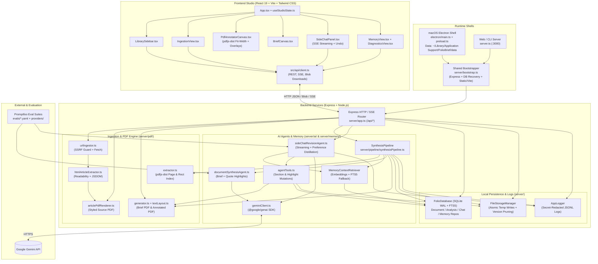
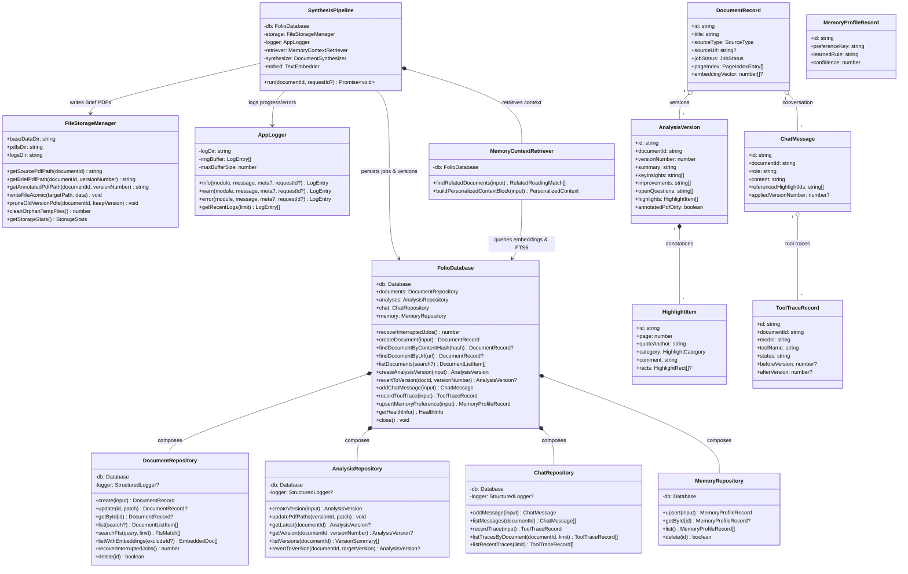

# FolioBrief Architecture & Project Structure

## 1. Software Architecture Diagram

FolioBrief runs as a local-first macOS desktop application (via Electron) or standalone local web server, keeping all documents, PDFs, reading history, and AI traces stored locally on disk while calling the Google Gemini API from the Node.js backend.



---

## 2. Class & Domain Model Diagram

The backend follows a repository-backed database facade (`FolioDatabase`) paired with dedicated storage (`FileStorageManager`), logging (`AppLogger`), cross-document retrieval (`MemoryContextRetriever`), and background orchestration (`SynthesisPipeline`).



---

## 3. Project & Folder Structure

```text
foliobrief/
├── package.json                  # Single manifest for all runtime, desktop, test, and eval dependencies
├── .env.example                  # Environment variable template (no real keys)
├── server.ts                     # Web/CLI HTTP server entrypoint (port 3000)
├── vite.config.ts                # Vite + React + Tailwind CSS build configuration
├── electron/                     # Native macOS desktop shell
│   ├── main.ts                   # Electron lifecycle, macOS menu bar, local Express bootstrap
│   └── preload.ts                # Sandboxed contextBridge preload script
├── server/                       # Backend Express API, SQLite persistence, PDF engine, AI agents
│   ├── app.ts                    # REST + SSE API routes (/api/documents, /pdf/*, /chat, /memory)
│   ├── bootstrap.ts              # Shared server startup & graceful shutdown (web + Electron)
│   ├── db.ts                     # FolioDatabase facade over WAL SQLite + FTS5
│   ├── storage.ts                # Atomic PDF file storage and old-version pruning
│   ├── logger.ts                 # Secret-redacted rotating JSONL logger
│   ├── ai/
│   │   ├── geminiClient.ts       # @google/genai client factory, retries, and embeddings
│   │   ├── documentSynthesisAgent.ts  # Structured brief & highlight synthesis
│   │   ├── sideChatRevisionAgent.ts   # Multi-turn SSE side-chat & preference distillation
│   │   └── agentTools.ts         # Deterministic revision tools creating immutable vN snapshots
│   ├── db/                       # Schema migrations, row guards, and domain repositories
│   ├── memory/
│   │   └── retriever.ts          # Cosine embedding + FTS5 cross-document context retriever
│   ├── pdf/
│   │   ├── articleTypes.ts       # Structured article block contracts
│   │   ├── urlIngestor.ts        # SSRF-guarded URL fetcher
│   │   ├── htmlArticleExtractor.ts    # Readability + JSDOM block extractor
│   │   ├── articlePdfRenderer.ts # Styled editorial Source PDF renderer for web/text inputs
│   │   ├── extractor.ts          # pdfjs-dist page/word bounding-box indexer & quote matcher
│   │   ├── generator.ts          # Executive Brief PDF & Annotated PDF (/Highlight + /Text) generator
│   │   └── textLayout.ts         # Shared WinAnsi sanitization and line-wrapping utilities
│   ├── pipeline/
│   │   └── synthesisPipeline.ts  # Background ingestion -> synthesis -> Brief PDF pipeline
│   └── utils/
│       └── jsonParser.ts         # Resilient structured JSON extraction helpers
├── src/                          # React 19 frontend studio
│   ├── App.tsx                   # Top-level studio shell
│   ├── api/client.ts             # Typed HTTP, SSE stream, and Blob download client
│   ├── hooks/useStudioState.ts   # Library polling, active workspace, chat streaming state
│   ├── shared/types.ts           # Shared TypeScript contracts across client and server
│   └── components/               # Workspace views (PdfAnnotatorCanvas, BriefCanvas, SideChatPanel, etc.)
├── evals/                        # Promptfoo evaluation suites and custom providers
├── tests/                        # Vitest unit and integration tests (client/ and server/)
└── doc/                          # Architecture diagrams, class diagrams, and visual assets
```
